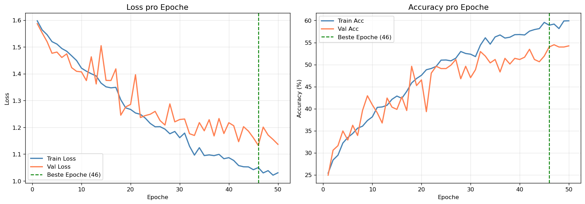
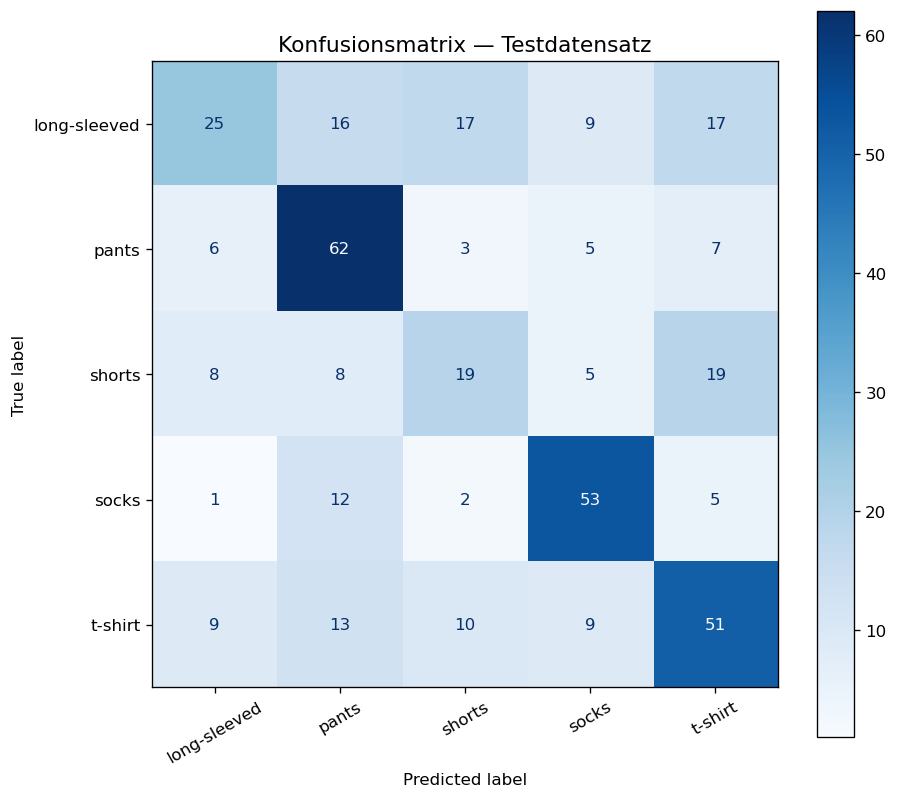
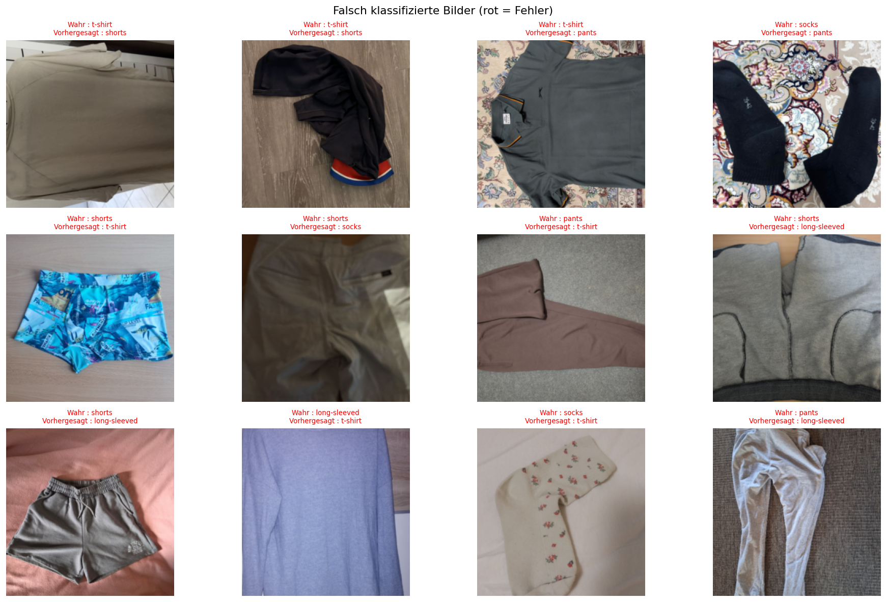

# Klassifikation von Kleidungsstücken mit einem CNN

Studienprojekt im Kurs **Deep Learning** (Technische Hochschule Mittelhessen, SoSe 2026).
Ein von Grund auf in **PyTorch** implementiertes Convolutional Neural Network ordnet Fotos von
Kleidungsstücken einer von fünf Klassen zu: `long-sleeved`, `pants`, `shorts`, `socks`, `t-shirt`.

**Autoren:** Vades Ngounouo Djoko, Lister Melaguie

---

## Ziel

- Einen realen, heterogenen Bilddatensatz analysieren (Auflösungen, Seitenverhältnisse, Klassenbalance)
- Eine vollständige Trainingspipeline aufbauen: Vorverarbeitung, Datenaugmentierung, Train/Val/Test-Split,
  Training mit Lernraten-Scheduling und Early Stopping
- Ein eigenes CNN (ohne vortrainierte Gewichte) trainieren und auf einem Testsplit sowie auf einem
  separaten, unbekannten Testdatensatz evaluieren
- Experimente mit **Weights & Biases** nachvollziehbar protokollieren
- Fehler analysieren und Verbesserungsmöglichkeiten ableiten

## Projektstruktur

```
.
├── cnn_3.ipynb                  # Haupt-Notebook: Analyse, Training, Evaluation, Inferenz
├── best_model.pth               # Gewichte des besten Modells (Early Stopping, Epoche 46)
├── results/                     # Ergebnisse (vom Notebook erzeugt)
│   ├── image_distribution.png       # Verteilung von Bildgrößen und Seitenverhältnissen
│   ├── class_distribution.png       # Klassenverteilung
│   ├── augmented_samples.png        # Beispiele augmentierter Trainingsbilder
│   ├── original_vs_augmented.png    # Original vs. augmentiert
│   ├── training_curves.png          # Loss- und Accuracy-Kurven
│   ├── confusion_matrix.png         # Konfusionsmatrix (Testsplit)
│   ├── misclassified.png            # Beispiele falsch klassifizierter Bilder
│   └── testdaten_klassifikation.csv # Vorhersagen auf dem externen Testdatensatz
└── presentation/
    ├── cnn_3_beamer_presentation.tex / .pdf  # Projektpräsentation (LaTeX Beamer)
    └── mnist_beamer_presentation.tex         # Präsentation eines weiteren Kursprojekts (MNIST, FCNN)
```

## Datensatz

| Klasse        | Bilder |
|---------------|-------:|
| long-sleeved  |    787 |
| pants         |    783 |
| shorts        |    767 |
| socks         |    781 |
| t-shirt       |    781 |
| **Gesamt**    | **3 899** |

- Alle Bilder RGB, Auflösung zwischen 224 px und 5 712 px, Seitenverhältnis 0,41–2,25
- Klassen gut ausbalanciert (max/min = 1,03) → keine Gewichtung der Verlustfunktion nötig
- Split (Seed 42): **80 % Training (3 119)**, **10 % Validierung (389)**, **10 % Test (391)**

> Der Datensatz und die Testdaten wurden im Rahmen des Kurses bereitgestellt und sind **nicht** Teil
> dieses Repositorys. Zum Ausführen müssen sie lokal als `dataset/<klasse>/*.jpg` bzw.
> `EiDL_TestDaten_SoSe26/<klasse>/*.jpg` abgelegt werden.

## Methodik

**Vorverarbeitung & Augmentierung**

| Training | Validierung / Test |
|---|---|
| `Resize(256)` → `RandomResizedCrop(224, scale=(0.8, 1.0))` | `Resize(256)` → `CenterCrop(224)` |
| `RandomHorizontalFlip(0.5)`, `RandomRotation(10°)` | – |
| `ColorJitter(brightness/contrast/saturation = 0.2)` | – |
| Normalisierung mit ImageNet-Mittelwerten | Normalisierung mit ImageNet-Mittelwerten |

**Architektur `ClothingCNN`** (ca. 456 000 Parameter)

```
Eingabe 3×224×224
→ 4 × [Conv2d 3×3 → BatchNorm → ReLU → MaxPool 2×2]   Kanäle: 32 → 64 → 128 → 256
→ Global Average Pooling
→ Dropout(0.3) → Linear(256, 256) → ReLU → Dropout(0.2) → Linear(256, 5)
```

**Training**

| Parameter | Wert |
|---|---|
| Verlustfunktion | CrossEntropyLoss |
| Optimierer | Adam, lr = 3·10⁻⁴, weight_decay = 10⁻⁴ |
| Scheduler | ReduceLROnPlateau (factor 0.5, patience 3) |
| Early Stopping | patience 7, Modell mit minimalem Val-Loss wird gespeichert |
| Batchgröße / Epochen | 32 / max. 50 |
| Hardware | CPU |

## Ergebnisse

### Training

Das beste Modell stammt aus **Epoche 46** (Val-Loss 1,133, Val-Accuracy 53,98 %). Die Lernrate wurde
schrittweise bis auf 1,9·10⁻⁵ reduziert; Train- und Val-Kurven liegen nah beieinander (geringes Overfitting,
eher Underfitting).



### Testsplit (391 Bilder)

**Gesamtgenauigkeit: 53,71 %** (Zufallsniveau bei 5 Klassen: 20 %)

| Klasse | Precision | Recall | F1 | Support |
|---|---:|---:|---:|---:|
| long-sleeved | 0,510 | 0,298 | 0,376 | 84 |
| pants        | 0,559 | 0,747 | 0,639 | 83 |
| shorts       | 0,373 | 0,322 | 0,345 | 59 |
| socks        | 0,654 | 0,726 | 0,688 | 73 |
| t-shirt      | 0,515 | 0,554 | 0,534 | 92 |
| **Macro-Ø**  | 0,522 | 0,529 | 0,517 | 391 |



### Externer Testdatensatz (EiDL_TestDaten_SoSe26, 99 Bilder)

**Genauigkeit: 55 / 99 = 55,56 %** – vergleichbar mit dem Testsplit, das Modell generalisiert also auf neue Bilder.

| Klasse | Richtig |
|---|---:|
| long-sleeved | 6 / 19 |
| pants        | 14 / 20 |
| shorts       | 10 / 20 |
| socks        | 12 / 20 |
| t-shirt      | 13 / 20 |

Alle Einzelvorhersagen mit Konfidenz: [`results/testdaten_klassifikation.csv`](results/testdaten_klassifikation.csv)

### Fehleranalyse

- **Stärkste Klassen:** `socks` und `pants` (markante Form)
- **Schwächste Klassen:** `long-sleeved` (häufig als `t-shirt` erkannt) und `shorts` (Verwechslung mit `pants`/`t-shirt`)
- Mögliche Ursachen: visuelle Ähnlichkeit der Oberteile bzw. Beinkleider, stark variierende Bildausschnitte,
  Verlust feiner Details durch vierfaches Pooling, begrenzte Kapazität eines kleinen, nicht vortrainierten Netzes



### Ausblick

- Transfer Learning mit vortrainierten Netzen (z. B. ResNet, EfficientNet)
- Längeres Training bzw. GPU-Training, tieferes Netz
- Gezieltere Augmentierung und Hyperparameter-Suche (z. B. W&B Sweeps)

## Verwendete Technologien

- **Python 3**, **Jupyter Notebook**
- **PyTorch** & **torchvision** (Modell, Datenpipeline, Augmentierung)
- **scikit-learn** (Klassifikationsbericht, Konfusionsmatrix)
- **NumPy**, **pandas**, **Matplotlib**, **Pillow**
- **Weights & Biases** (Experiment-Tracking)
- **LaTeX Beamer** (Präsentation)

## Ausführen

```bash
pip install torch torchvision scikit-learn numpy pandas matplotlib pillow wandb jupyter

# optional, für das Experiment-Tracking
export WANDB_API_KEY=<dein-key>

jupyter notebook cnn_3.ipynb
```

Datensatz unter `./dataset/` ablegen (ein Unterordner pro Klasse). Für reine Inferenz genügt die letzte
Notebook-Zelle zusammen mit `best_model.pth` und den Testbildern unter `./EiDL_TestDaten_SoSe26/`.
